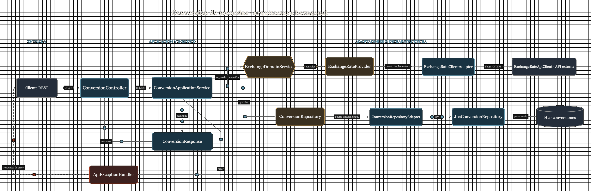

# API de tipo de cambio

Microservicio en Java que consulta un tipo de cambio externo, convierte un monto y guarda cada conversión exitosa en H2. La API usa [ExchangeRate-API](https://www.exchangerate-api.com/docs/overview) como proveedor de tasas.

## Flujo de conversión



El diagrama editable está en [`docs/exchange-service.fluyo.json`](docs/exchange-service.fluyo.json).

## Tecnologías

- Java 17, Spring Boot 4.0.6 y Maven.
- Spring Cloud OpenFeign 2025.1.1 para consultar el proveedor.
- Spring Data JPA y H2 en memoria para guardar las conversiones.
- JUnit, Mockito y MockMvc para las pruebas.

## Estructura

El proyecto separa el dominio de los detalles de HTTP y persistencia:

```text
src/main/java/pe/test/exchange/
├── domain/          Modelo de conversión, código de moneda, reglas y contratos
├── application/     Endpoint, DTOs, mapeo y orquestación de la conversión
└── infrastructure/  Cliente Feign y repositorio JPA/H2
```

`POST /api/conversion` valida la solicitud, obtiene la tasa, calcula el monto convertido y guarda la operación. Si ambas monedas son iguales, usa tasa `1` **sin consultar al proveedor**, pero también guarda la conversión. En ese caso se comprueba localmente que el código de moneda exista.

## Ejecutar

Necesitas Java 17 o superior y una API key válida de ExchangeRate-API. Configúrala como variable de entorno antes de arrancar:

```bash
export EXCHANGE_RATE_API_KEY=tu_api_key
bash ./mvnw spring-boot:run
```

La aplicación queda en `http://localhost:8080`. `.env.example` sirve de referencia, pero Spring Boot **no carga `.env` automáticamente**. No publiques tu API key.

El cliente Feign `exchangeRateApi` tiene un timeout de conexión de **2 segundos** y uno de lectura de **5 segundos**, configurados en `src/main/resources/application.yaml`.

## API de conversión

`POST /api/conversion` con `Content-Type: application/json`:

```json
{
  "monto": 100,
  "monedaOrigen": "USD",
  "monedaDestino": "PEN"
}
```

Una respuesta exitosa (`200 OK`) contiene:

```json
{
  "monto": 100,
  "montoConvertido": 370.00,
  "monedaOrigen": "USD",
  "monedaDestino": "PEN",
  "tipoCambio": 3.70
}
```

**La tasa del ejemplo es ilustrativa:** en una conversión entre monedas distintas, la respuesta utiliza la tasa recibida del proveedor en ese momento.

- `monto` debe ser un número mayor que cero; admite hasta 15 dígitos enteros y 4 decimales significativos. No se acepta un número enviado como texto.
- `monedaOrigen` y `monedaDestino` deben ser códigos de tres letras; se admiten minúsculas y se normalizan a mayúsculas. Si el proveedor no admite una moneda, la solicitud se rechaza.
- El monto convertido se redondea a 2 decimales. Si la tasa o el resultado no pueden guardarse sin exceder la precisión de H2, la operación se rechaza.

Puedes probar el endpoint con la colección [`bruno/`](bruno/): abre esa carpeta en Bruno, selecciona el entorno `local` y ejecuta **Convert currency**. La API key se configura en el backend, no en Bruno.

### Errores

Los errores manejados se devuelven con `status`, `title`, `detail` e `instance` (formato `ProblemDetail`).

| Estado | Cuándo ocurre | Qué hacer |
|---|---|---|
| `400 Bad Request` | JSON inválido, tipo de dato incorrecto, monto fuera de los límites o moneda no soportada | Corregir la solicitud según `detail` |
| `502 Bad Gateway` | El proveedor falla, agota el timeout o devuelve una tasa inválida | Mostrar el mensaje genérico y permitir intentar más tarde |

Ejemplo de `400` para un monto enviado como texto:

```json
{
  "detail": "El monto debe ser un número",
  "instance": "/api/conversion",
  "status": 400,
  "title": "Bad Request"
}
```

Ejemplo de `502`:

```json
{
  "detail": "No fue posible obtener el tipo de cambio en este momento. Inténtalo más tarde",
  "instance": "/api/conversion",
  "status": 502,
  "title": "Bad Gateway"
}
```

Un problema interno como una API key inválida **no se expone al cliente**. El backend registra el estado HTTP y el tipo de error del proveedor para diagnóstico, sin registrar la clave ni la URL que la contiene. Para decidir qué mostrar, un frontend puede usar el estado HTTP y `detail`; no debería basar su lógica en comparar textos de mensajes.

## Persistencia en H2

Cada conversión exitosa guarda monto original, monedas, tasa aplicada, monto convertido y fecha de operación en la tabla `conversions`. La fecha se genera en **UTC** y se almacena como `LocalDateTime` (sin zona horaria en la columna); se interpreta como UTC por convención.

Con la aplicación en ejecución, abre `http://localhost:8080/h2-console` y utiliza:

| Campo | Valor |
|---|---|
| JDBC URL | `jdbc:h2:mem:testdb` |
| Usuario | `sa` |
| Contraseña | `password` |

```sql
SELECT id, original_amount, source_currency, target_currency,
       exchange_rate, converted_amount, operation_date
FROM conversions
ORDER BY id DESC;
```

H2 está **en memoria**: los registros desaparecen al detener la aplicación. Una conversión rechazada no se guarda.

## Pruebas

```bash
bash ./mvnw test
```

Las pruebas usan una clave de prueba y no necesitan una API key real. Cubren cálculo, validación, errores del proveedor, persistencia y timeouts. La prueba del proveedor lento usa un servidor HTTP local y un timeout reducido **solo dentro del test**, para comprobar que un fallo no inserta datos en H2 sin esperar cinco segundos.
